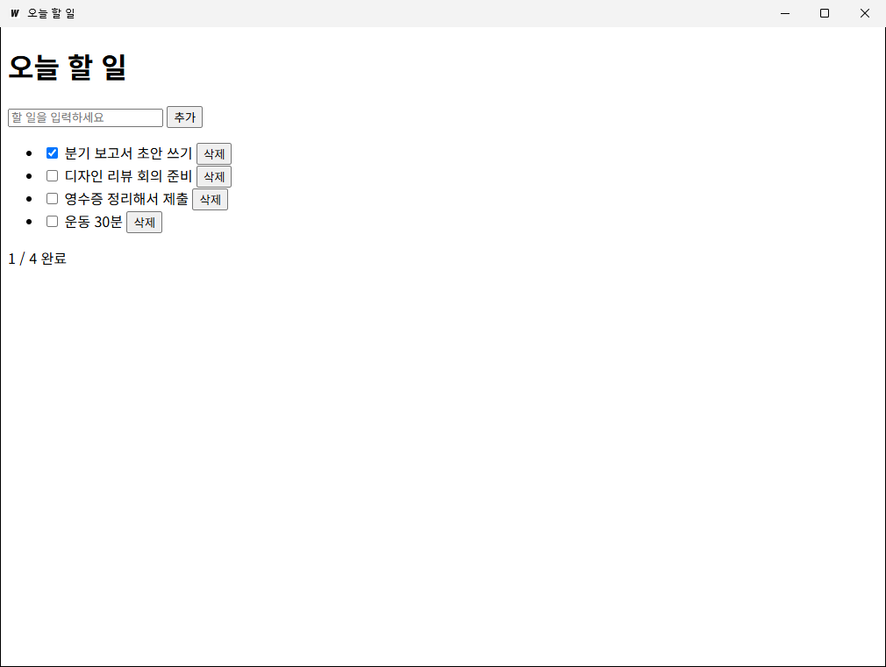
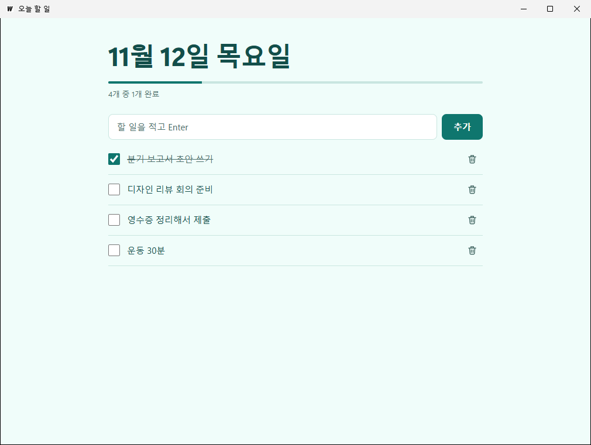

# desktop-app-factory

간단한 HTML 페이지를 [Wails v2](https://wails.io) Windows 데스크톱 앱(.exe)으로 만드는 Claude Code 플러그인.
가장 먼저 빌드 환경을 점검하고, Go·Wails CLI·WebView2 중 없는 것을 안내한 뒤 (동의를 받고) 설치한다. winget이 없는 PC에서는 Go를 공식 zip(SHA256 검증)으로 관리자 권한 없이 설치한다. Rust, Visual Studio C++ 빌드 도구, Node.js는 필요 없다.

## 설치

```
/plugin marketplace add tourbut/desktop-app-factory
/plugin install desktop-app-factory@desktop-app-factory
```

## 사용

```
/desktop-app-factory:html-to-desktop ./my-page
```
또는 그냥 "my-page 폴더 HTML을 데스크톱 앱으로 만들어줘"라고 요청한다.

흐름: 환경 점검(없는 것 안내 → 동의 후 설치) → 입력 확인 → (선택) 디자인 다듬기 → 프로젝트 생성 → `wails build` → 앱 창 스크린샷으로 화면 확인 → (선택) `wails build -nsis` 설치 파일.

만들어진 프로젝트는 HTML 폴더(`web/`)를 Go `embed`로 exe 안에 넣는다. npm 빌드 단계는 없다. `app.go`의 `App` 구조체 메서드를 HTML에서 `window.go.main.App.<메서드>()`로 불러 Go 코드(예: 로컬 파일 읽기/쓰기)를 쓸 수 있다. 메서드 추가 방법은 `skills/html-to-desktop/SKILL.md` 3단계에 있다.

### 예제

`examples/memo/`는 꾸밈 없는 할 일 목록 HTML이다(`SaveText`/`LoadText`로 저장). `examples/memo-designed/`는 같은 페이지에 디자인 다듬기 단계를 적용한 결과다.

| 패키징만 | 디자인 다듬기 후 |
|---|---|
|  |  |

## 함께 설치되는 것

`desktop-app-factory`를 설치하면 아래 디자인 플러그인이 의존성으로 함께 설치된다. 모두 이 마켓플레이스에 원본 GitHub 저장소를 가리키는 항목으로 등록돼 있다.

| 플러그인 | 원본 | 용도 |
|---|---|---|
| `frontend-design` | [anthropics/claude-plugins-official](https://github.com/anthropics/claude-plugins-official/tree/main/plugins/frontend-design) | 미적 방향·타이포그래피 |
| `ui-ux-pro-max` | [nextlevelbuilder/ui-ux-pro-max-skill](https://github.com/nextlevelbuilder/ui-ux-pro-max-skill) | 스타일·팔레트·폰트 조합 DB |
| `impeccable` | [pbakaus/impeccable](https://github.com/pbakaus/impeccable) | critique / audit / polish |

## 구성

| 파일 | 역할 |
|---|---|
| `skills/html-to-desktop/SKILL.md` | 작업 순서 (환경 점검/설치 → 입력 확인 → 프로젝트 생성 → 빌드 → 화면 확인) |
| `skills/html-to-desktop/scripts/setup-windows.ps1` | Go·Wails CLI·WebView2 항목별 점검, `-Install`로 설치(winget, 없으면 공식 파일 직접), `-Nsis`로 NSIS까지 |
| `skills/html-to-desktop/scripts/scaffold.ps1` | HTML 폴더를 Wails v2 프로젝트로 감싸기 (`template/` 복사 + `go mod tidy`) |
| `skills/html-to-desktop/scripts/screenshot.ps1` | 빌드된 exe를 띄워 앱 창을 PNG로 저장 (Windows 기본 .NET만 사용) |
| `skills/html-to-desktop/template/` | `main.go`, `app.go`(예제 Go 메서드), `app_test.go`, `wails.json`, `go.mod` |

## 제한

- Windows 전용. Windows에서 Windows용(amd64) exe만 만든다. macOS/Linux 빌드는 지원하지 않는다.
- Wails v2.17.1, Go 1.26 이상이 필요하다.
- 실행 PC에 WebView2 런타임이 있어야 한다(Windows 11 기본 포함, Windows 10은 대부분 포함). NSIS 설치 파일은 없으면 설치 중에 내려받는다.
- 앱 이름이 한글이면 exe 이름도 한글이다(`한글 메모장.exe`). `-Slug`로 바꿀 수 있다.
- 코드 서명·UPX 압축·자동 업데이트는 하지 않는다. 서명 안 된 exe는 처음 실행할 때 SmartScreen 경고가 날 수 있다("추가 정보" → "실행").
- 설치 파일로 앱을 제거해도 사용자 데이터(`%APPDATA%\<앱이름>`)는 남긴다.
- 0.2.x(Tauri)에서 쓰던 Tauri MCP 서버(`tauri`)와 `--mcp-bridge` 화면 검수는 없앴다. 대신 `screenshot.ps1`로 실제 앱 창을 찍어 Claude가 본다.
- 화면 확인은 스크린샷만 한다. 클릭·입력 같은 상호작용 자동화나 콘솔 로그 수집은 없다(콘솔은 `wails build -devtools` 후 Ctrl+Shift+F12).

## 문제 해결

`skills/html-to-desktop/SKILL.md`의 "문제 해결"을 본다. 자주 나오는 것:

- `wails`를 못 찾음: `%USERPROFILE%\go\bin`이 PATH에 없다. 새 터미널을 연다.
- 한글 깨짐: HTML에 `<meta charset="utf-8">`이 없다.
- `window.go is undefined`: HTML을 브라우저로 직접 열었다. Go 호출은 빌드된 앱 안에서만 된다.
